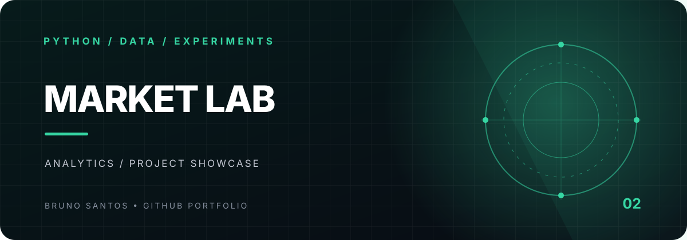

<div align="center">



# MARKET AUTOMATION LAB
### PYTHON / API / DATA EXPERIMENTS

Laboratório experimental em estágio inicial para estudar Python, APIs e automação aplicada a dados de mercado. A estrutura atual contém uma API mínima com FastAPI.

[](https://github.com/brunosg24/bruno-robo-day-trade)


</div>

---

## ✦ Visão do projeto

Laboratório experimental em estágio inicial para estudar Python, APIs e automação aplicada a dados de mercado. A estrutura atual contém uma API mínima com FastAPI.

## ◈ Recursos / escopo

Aplicação FastAPI inicial e estrutura básica de configuração e dependências.

## ⌘ Tecnologias

Python · FastAPI

## ▶ Começar

```bash
git clone https://github.com/brunosg24/bruno-robo-day-trade.git
cd bruno-robo-day-trade
```

Crie um ambiente virtual, instale `backend/requirements.txt` e execute `uvicorn backend.app:app --reload` a partir da raiz do projeto.

## 🧭 Próximos passos

- [ ] Evoluir a estrutura e os componentes do projeto.
- [ ] Melhorar experiência em dispositivos móveis.
- [ ] Documentar decisões técnicas e arquitetura.
- [ ] Adicionar testes e validações conforme as funcionalidades forem implementadas.

## ⚑ Status e transparência

Ainda não implementa robô de operações, análise preditiva funcional ou execução de ordens. Revise configurações e nunca publique credenciais.

<div align="center">

**BRUNO S.** · [GitHub](https://github.com/brunosg24)

</div>
